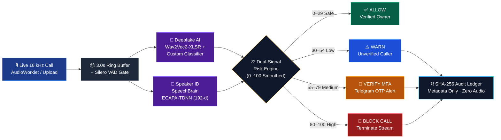
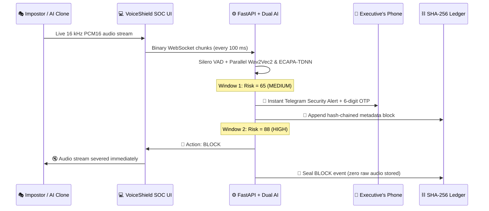

<div align="center">

# 🛡️ VoiceShield AI
### *Real Voices · Real Trust · Safer Tomorrow*

**Real-Time AI Voice Cloning Detection, Speaker Verification & Active Call Prevention**

[[https://img.shields.io/badge/Hack--N--Pitch-E--Summit%20'26-orange?style=for-the-badge]](https://github.com/Krishna159357/VoiceShield-AI)
[[https://img.shields.io/badge/Track-Blockchain%20%26%20Cybersecurity-1d4ed8?style=for-the-badge]](https://github.com/Krishna159357/VoiceShield-AI)
[[https://img.shields.io/badge/Val%20Accuracy-95.0%25-10b981?style=for-the-badge]](https://github.com/Krishna159357/VoiceShield-AI)
[[https://img.shields.io/badge/Privacy--First-Zero%20Raw%20Audio-0f172a?style=for-the-badge]](https://github.com/Krishna159357/VoiceShield-AI)

[https://img.shields.io/badge/Python-3.11-3776AB?logo=python&logoColor=white]
[https://img.shields.io/badge/FastAPI-WebSockets-009688?logo=fastapi&logoColor=white]
[https://img.shields.io/badge/PyTorch-Wav2Vec2%20%7C%20ECAPA--TDNN-EE4C2C?logo=pytorch&logoColor=white]
[https://img.shields.io/badge/MFA-Telegram%20Bot%20API-26A5E4?logo=telegram&logoColor=white]
[https://img.shields.io/badge/Audit%20Ledger-SHA--256%20Hash%20Chain-003B57?logo=sqlite&logoColor=white]

**Team SHRESTH** — Yash · Shrwan · Krishna Kant · Sujit *(Jadavpur University)*

</div>

---

## 🚨 Why VoiceShield AI?

> **3 seconds** of audio is enough to clone a CEO's or official's voice. Today, humans decide whether to trust a live caller—and fraud is only discovered *after* the money is gone.

**VoiceShield AI** shifts defense from *"detection after damage"* to a live **Detect → Decide → Prevent** loop: analyzing streaming 16 kHz call audio in real time, combining **AI Deepfake Detection** with **Speaker Verification**, triggering **real out-of-band MFA** or **auto-blocking** the call, and sealing every alert in a **tamper-evident SHA-256 hash chain**.

---

## 🧠 Real-Time Pipeline Architecture



---

## ⚡ How an Attack Is Stopped in Real Time



---

## 📊 Custom Transfer-Learning Model Performance

Pretrained deepfake detectors suffer from domain shift on real laptop microphones. We solved this by freezing the multilingual [`Gustking/wav2vec2-large-xlsr-deepfake-audio-classification`](https://huggingface.co/Gustking/wav2vec2-large-xlsr-deepfake-audio-classification) backbone, combining its hidden-state embeddings with **MFCC, spectral flatness, and zero-crossing rate**, and training a custom transfer-learning classifier on real microphone speech vs. neural TTS voices:

| Metric | Score | Visual |
| --- | --- | --- |
| **Overall Validation Accuracy** | **95.0%** | `███████████████████░` |
| **Real Human Recall** *(Zero False Positives)* | **100.0%** | `████████████████████` |
| **AI / Deepfake Precision** | **100.0%** | `████████████████████` |
| **Macro F1-Score** | **0.95** | `███████████████████░` |

---

## ✨ Working Features Built

| Module | What It Actually Does |
| --- | --- |
| **🎙️ Live Call Protection** | Streams 16 kHz PCM16 audio via [Web Audio `AudioWorklet](https://developer.mozilla.org/en-US/docs/Web/API/Web_Audio_API/Using_AudioWorklet)` over [FastAPI WebSockets](https://fastapi.tiangolo.com/advanced/websockets/) with a real-time waveform canvas, live dual-signal meters, and automatic call termination on High Risk. |
| **🧬 Privacy-First Enrollment** | Enroll any user by name via **5-second live mic** or **uploaded audio file** using [`speechbrain/spkrec-ecapa-voxceleb`](https://huggingface.co/speechbrain/spkrec-ecapa-voxceleb). Saves *only* a 192-dim `.npy` math vector—raw audio is deleted immediately. |
| **🔍 AI vs. Real Forensic Scanner** | Upload any suspicious `.wav`/`.mp3`/`.m4a` voice note **or** use the built-in **timed live voice recorder** (`00:00`) to detect synthetic speech and identify the closest enrolled speaker. |
| **📲 Real Out-of-Band MFA** | Sends instant security alerts and 6-digit OTPs to a real phone via the [Telegram Bot API](https://core.telegram.org/bots/api) when Medium/High risk triggers. |
| **⛓️ Tamper-Evident Audit Ledger** | Logs metadata-only SQLite records chained with `SHA-256(prev_hash | payload)` and a live **Verify Ledger Integrity** button to detect any tampering. |

---

## 🚀 Quick Start (Run Locally in 3 Minutes)

```bash
# 1. Clone & set up Python 3.11 virtual environment
git clone [https://github.com/Krishna159357/VoiceShield-AI.git](https://github.com/Krishna159357/VoiceShield-AI.git)
cd VoiceShield-AI
python -m venv .venv

# Windows PowerShell:
.venv\Scripts\Activate.ps1
# Mac / Linux:
source .venv/bin/activate

# 2. Install dependencies
python -m pip install -r requirements.txt

# 3. (Optional) Train custom classifier on your microphone + neural TTS
python -m backend.generate_ai_data
python -m backend.train_model

# 4. Launch the live VoiceShield AI SOC server
python -m uvicorn backend.main:app --port 8000

```

Open **`http://localhost:8000`** in Chrome.

*(Stage Tip: set `HF_HUB_OFFLINE=1` before launching Uvicorn to boot in ~2 seconds with zero Wi-Fi dependency.)*

1. Message `@BotFather` on Telegram → `/newbot` → copy your bot token, then tap **Start** inside your new bot's chat.
2. Message `@userinfobot` → copy your numeric `Id`.
3. Create a `.env` file in the root folder (hidden from Git via `.gitignore`):

```env
TELEGRAM_BOT_TOKEN=your_bot_token_here
TELEGRAM_CHAT_ID=your_chat_id_here

```

```text
voiceshield-ai/
├── backend/
│   ├── main.py                # FastAPI server, WebSockets, enrollment & forensic scanner
│   ├── deepfake_model.py      # Silero VAD + Wav2Vec2-XLSR + custom transfer-learning head
│   ├── speaker_verify.py      # Privacy-first ECAPA-TDNN enrollment & cosine similarity
│   ├── risk_engine.py         # Dual-signal 3-window smoothed risk engine
│   ├── mfa_alerts.py          # Real-time Telegram Bot API OTP alerts
│   ├── audit_ledger.py        # Metadata-only SQLite + SHA-256 cryptographic hash chain
│   ├── generate_ai_data.py    # Neural TTS sample generator (edge-tts)
│   └── train_model.py         # Custom classifier training & validation metrics
├── frontend/
│   ├── index.html             # Live Cybersecurity SOC Dashboard
│   └── pcm-processor.js       # 16 kHz Int16 PCM AudioWorklet processor
├── .env.example
├── .gitignore
├── requirements.txt
└── README.md

```

---

Push your updated visual `README.md` right now:

```powershell
git add README.md requirements.txt
git commit -m "docs: add visual README with Mermaid architecture diagrams, badges, and accuracy scorecard"
git push

```

Refresh [your GitHub repo](https://github.com/Krishna159357/VoiceShield-AI) after pushing—both Mermaid diagrams, the badges, and the accuracy bars will render live right on your homepage!
